<table align="center">
  <tr>
    <td>
      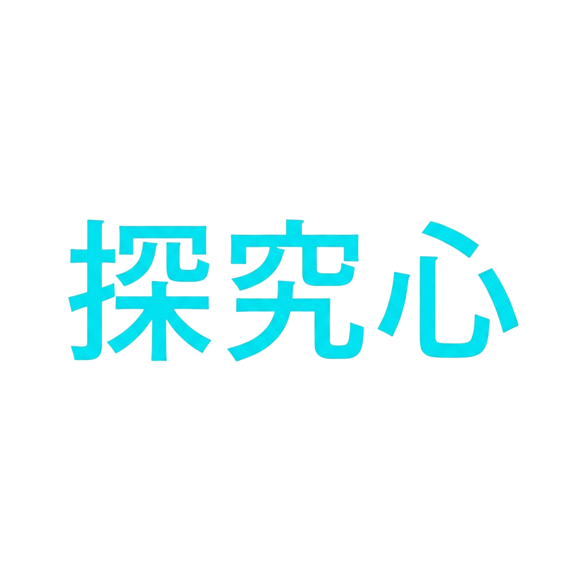
    </td>
    <td>
      <h1>कौतूहल (Kautūhala)</h1>
    </td>
  </tr>
</table>

<p align="center">
  <strong>Curiosité · 探究心 · कौतूहल</strong>
  <br />
  <em>Wonder → Explore → Build → Understand → Become → Wonder</em>
</p>

A small guild of curious builders, exploring computing and engineering through **hard questions, experiments, and real systems.**

A team is assembled to finish a deliverable. A guild is assembled to become **capable of more.**

> **Projects are expeditions. Technologies are tools. Failures are maps. Curiosity is why we keep moving.**

A thought experiment 🎲

A party enters an unknown world. One carries a sword. One studies magic. One builds machines. One draws the map.

Four weapons. One reason to go in. That reason has a name: **कौतूहल.**

---

## 1. 🪧 The Beginning: "I Want to Know"

The name is permanent. Everything else may evolve; the name is the fixed point.

> **"I want to know."**

Curiosity here is not passive. Watching videos, collecting facts, murmuring *"huh, interesting"*: none of it counts. Curiosity is a loop that ends in an artifact:

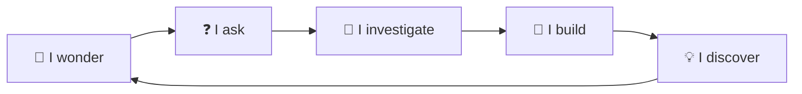

No terminal state. Deliberate. A system with an exit condition is a system that eventually exits.

> 🧭 **Every answer is allowed to create another question.**

Three languages, one spirit:

| Symbol | Meaning |
|---|---|
| 🇮🇳 **कौतूहल, Kautūhala** | The need to understand |
| 🇫🇷 **Curiosité** | Curiosity that wants to explore |
| 🇯🇵 **探究心, Tankyūshin** | The spirit of inquiry |

Our expression of curiosity is **engineering.** Not wondering how the machine works. **Opening it.** 🔧

### 🎯 The purpose, as one line

$$
\text{Curiosity}
\xrightarrow{\text{learn} \to \text{build} \to \text{test} \to \text{debug} \to \text{understand}}
\text{Demonstrated Capability}
$$

The guild exists to run this transformation. Everything else—ranks, quests, offices—is scaffolding around the arrow. Any structure that doesn't serve the arrow is decoration. Delete it.

---

## 2. 🌌 One Philosophy, Three Scales

One idea at three magnifications.

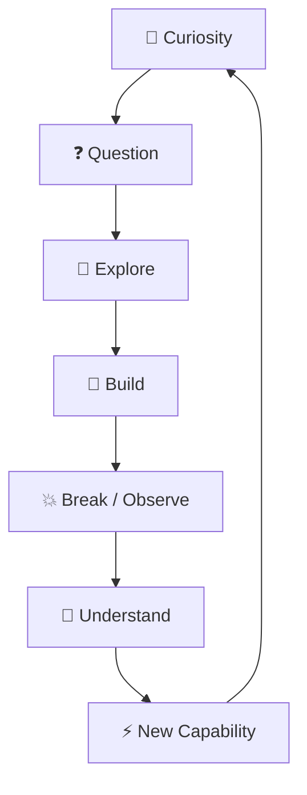

```text
Individual   Learn → Build → Break → Understand → Grow
Project      Problem → Explore → Prototype → Engineer → Deploy → Feedback
Guild        Curiosity → Expeditions → Shared Experience → Capability → New Territory
```

A member learns. A project tests the learning. The guild archives the result. Then the guild can enter territory it couldn't enter yesterday.

> 🌱 **The goal is not to know everything. The goal is to become capable of exploring more.**

### 🧬 Collective memory: the quiet third requirement

People graduate. Projects end. If the experience leaves with the people, the guild resets to zero every few years and the whole exercise is pointless.

**The guild must remember what it learned, after the people who learned it are gone.**

This, not bureaucracy, is the reason for repositories, records, and write-ups. The reason is *persistence.*

---

## 3. 🏹 The Guild: One Party, Many Paths

Why a guild, and not a club, a team, or a society?

Because we don't want everyone to become the same kind of engineer.

Shared direction. **Autonomous territories.**

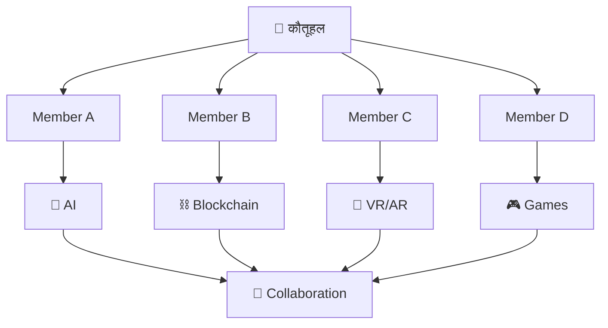

One member goes into AI. Another disappears into blockchain. Another builds games. Someone eventually finds a territory with no name yet. Good. That's the system working.

> 🗺️ **Different paths are not fragmentation. They are how the map grows.**

Autonomy is a founding value, not a perk. Each member chooses a niche in computer science. That niche is their **Class**. Nobody approves it. Nobody assigns it.

### ⚖️ The equal floor

Design constraint: **everyone stands on the same floor.**

```text
Rank → influence   ✅
Rank → privilege   ❌
```

Rank may earn influence: whose voice carries, who leads quests. Rank may never earn privilege.

Informal label: **socialist.** Not communist: nobody is flattened into sameness. Not capitalist: nobody buys their way up. An equal floor with a ladder bolted on.

### 🧭 Who decides what

```text
Member            → chooses their territory
Guild             → chooses its direction
Master Architect  → guards the compass
```

Members are autonomous in **what they explore and how they solve it.** The Master Architect holds the **direction**: identity, standards, ambition, long-term character. They do not micromanage technical decisions.

**Members are explorers, not soldiers.**

### 🔄 Succession

A single point of failure is a bug. Leadership is **handed over**, never seized by default.

- The Master Architect chooses their successor.
- Every officer chooses theirs.
- A graduating officer's seat goes to someone they trust.

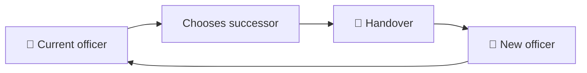

Counterweight: power that can only be handed down is dangerous if it can never be taken back. The Master Architect must be removable by their **immediate predecessor** and by the **officers acting together**. The governing procedures are established in the guild constitution.

The principle is simple: **no seat is permanent, including the top one.**

### 🔓 Open door, closed treasury

- Any student of the college may apply. Everyone starts at the bottom. No entrance exam, no pedigree. 🚪
- The guild holds no funds and charges no fees. Curiosity should not have a price tag.
- The guild lives *inside* the college. It does not pretend to stand above it.

---

## 4. ⚔️ The Party

Every expedition needs people who keep it moving.

```text
                 🧭 MASTER ARCHITECT
                      YASHASVI
                          │
          ┌───────────────┼───────────────┐
          │               │               │
    ⚔️ DEBUG OFFICER ⚔️ DEBUG OFFICER ⚔️ DEBUG OFFICER
        BITTU           RAGNI          SURYANSH
          │               │               │
          └───────────────┼───────────────┘
                          │
                    🛡️ GIT STAFF
                 ISHAQUE  ·  SURBHI
                          │
                      👥 MEMBERS
                          │
                  ┌───────┴───────┐
                RANK            CLASS
                F → S         Territory
                  │
                QUESTS
```

### 🧭 Master Architect

Keeps the direction, philosophy, standards, ambition, and long-term character. Alone issues the **guild-wide quest**, the kind the whole guild walks together. Final voice when a member is accused of harming the guild. Interpreter when a rule is unclear.

**First: Yashasvi.**

### ⚔️ Debug Officers

Keep the expedition alive: coordination, collaboration, project activity, quests, debug support, and code review.

They also **judge promotions**; they test whether a member's capability is real. Their job is to make things move, **not** to become bureaucrats.

**First: Bittu, Ragni, and Suryansh.**

Eventually: one per branch, per year of study.

### 🛡️ Git Staff

Keep the guild's technical memory: repositories, version control, contribution workflow, recovery, and the full scribing of projects **for the next generation.**

They confirm that quests are actually complete.

**First: Surbhi and Ishaque.**

Eventually: two per year of study.

> **Infrastructure removes friction. It does not judge expeditions.**

Every officer is also just a member with a rank. The title adds **responsibility**, not status.

---

## 5. 🧩 Your Character: Rank + Class

Every adventurer has two independent properties.

### ⚔️ Rank: "What can you currently do?"

```text
F → E → D → C → B → A → S
```

Rank is **demonstrated capability and contribution.** Not intelligence. Not popularity. Not worth as a human. Certainly not volume in the group chat. 😂

A rank is a current state, not an identity. It can rise. Direction can change.

> ⚔️ **Rank measures capability. Curiosity is independent of rank.**

Each rank is a chapter, not a score:

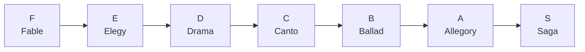

Begin as a fable. End as a saga. The exact skills for each chapter are defined by the guild's constitution; the names are the meaning.

Anchors, pegged to **college level**, not Linus level:

```text
F  → Total newbie. Milestone: the first Git commit.
C  → Command of one language and a framework around it.
S  → Has forged a venture of their own or left a mark on open source.
```

Between them: a gradient from "can write code" to "can ship something real."

### 🗺️ Class: "Where are you exploring?"

Current territories:

- 🧠 Artificial Intelligence & Machine Learning
- ⛓️ Blockchain & Decentralized Systems
- 🌐 Web Engineering
- 📱 Application Development
- 🎮 Game Development & Interactive Systems
- 🤖 Embedded Systems, IoT & Robotics
- ⚙️ Systems Programming & Infrastructure Software
- ☁️ Cloud Computing & Platform Engineering
- 🛡️ Cybersecurity Engineering
- 🥽 Extended Reality & Spatial Computing
- 🗄️ Data Engineering & Analytics
- 📐 Scientific Computing & Algorithm Engineering
- 🧩 Backend Engineering, Developer Tooling & Automation

More will appear as new land is entered. The list is deliberately not frozen. A frozen map is a dead map.

Class is a niche in computer science. **Free to change while you're still finding yourself. Fixed on reaching Allegory.** By then you should have planted a flag.

$$
\text{Character} = (\text{Rank},\ \text{Class})
\qquad
\text{Rank} \perp \text{Class}
$$

```text
C Rank · AI
A Rank · Backend
F Rank · Blockchain
```

No contradiction. Strong in one territory, a beginner in another. That's simply what an explorer looks like.

### 📉 Going quiet

A member with no activity for long enough is a name on a list, not a member.

- The newest, least-proven members are first to lose their place if they vanish.
- The mid-ranks slip down a step instead of disappearing.
- Those who have already proven themselves, and the founders, are not punished for silence.

**Activity is evidence.** Without evidence for long enough, the record updates. Not a punishment. A correction.

Those who leave, or are removed, face a cooling-off period and return at the start. Nobody skips the ladder. 🪜

---

## 6. 📜 Quests: Where Curiosity Becomes Real

Enough philosophy. **What do we actually do?**

We go on quests. The board converts:

```text
"That looks interesting..."
```

into:

```text
"Let's build it."
```

A quest never says ❌ **Learn React.** It says ✅ **Build something that forces you to understand X.**

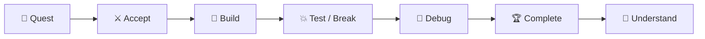

Scale: one member (solo), a small party (squad), or the whole guild (a guild-wide quest, from the Master Architect alone).

### 🧱 Principles of the quest system

1. **The board is curated.** Quests are posted by those who carry responsibility for direction: Debug Officers and the Master Architect.
2. **Every quest has a rank.** The rank represents the level at which a member could complete it with reasonable effort. Quests are the growth mechanism, so they sit slightly above comfort. **One rank up, never more.**
3. **Parties are small.** Small enough that every member is load-bearing. One scribe per party documents the work and talks to the Git Staff. 🖋️
4. **A quest counts only if confirmed.** Abandoned or unreported quests don't exist. History must be *evidenced.*
5. **Credit is sacred.** People are credited for what they build. Nobody's work vanishes into "the team."
6. **Bugs are expected.** Hunting them is half the game. 🐛

A college competition can be the *reason to start.* It must never be the reason it *matters.*

> **"Would this still be worth building if nobody at college cared?"**

If yes, **now we're talking.** 🏹

Good quests are **Visionary · Practical · Engineering-driven · Expandable · Meaningful.**

---

## 7. 🧠 The Engineer's Mind: Model Before Syntax

This is where कौतूहल stops being a coding club.

We don't want people who merely remember syntax. We want people who look at a machine and ask:

> **"What is actually happening?"**

Programming is not an isolated box.

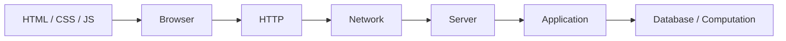

The goal is not *"I know JavaScript."* The goal is **"I understand where JavaScript sits inside the machine."**

Two directions of learning.

### 🔍 Decomposition

Take it apart, find the layers, and ask what each one does.

```text
Web → Browser → Network → OS → Hardware
```

### 🔨 Construction

Put it back together.

```text
Problem → Architecture → Implementation → Testing → Deployment
```

> 🧠 **An engineer must learn to take systems apart, and build them back up.**

That is the actual training.

### 🛠️ Tools are allowed. Understanding is not optional.

AI and third-party code are fine, *if credited and understood.*

The test: **Can you explain it?**

If not, you didn't build it. You borrowed it. 🪞

---

## 8. 🧪 Break Things

You are allowed to be wrong here. ✅

Terrible code. Wrong architecture. Stupid assumption. Crash. A completely failed prediction. None of these is the enemy.

The enemy is **learning nothing from them.**

```text
Prediction → Implementation → Reality
                              ↓
                       💥 Unexpected Result
                              ↓
                         🐛 Debugging
                              ↓
                       🔎 Hidden Assumption
                              ↓
                    🧠 Revised Model → Try Again
```

The most valuable moment in engineering:

$$
\boxed{\text{What I predicted} \neq \text{What actually happened}}
$$

Reality just corrected your model.

> 💥 **Failure is not the opposite of learning. Failure is data.**

Therefore honest bugs and honest failure are **never** misconduct here. Dishonesty is. Claiming another's work is. Hiding what you did is. A crash never is. 🧯

### 🗣️ Socratic Learning

Don't just give the answer. Explain **why you believe it.**

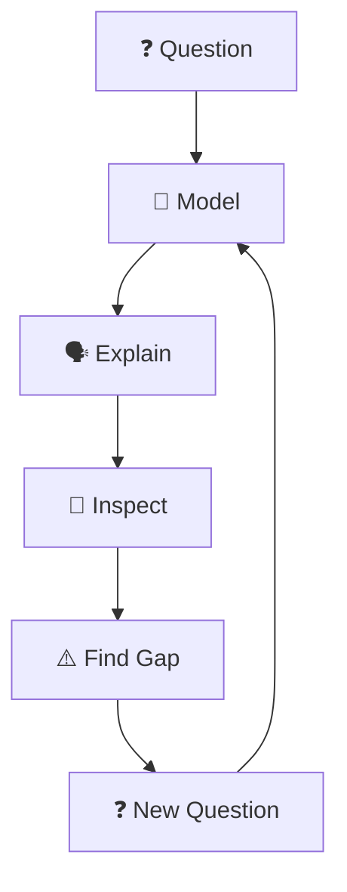

Wrong metric: *"How many things do I know?"*

Right metric: **"How accurate are my models?"**

$$
\text{Understanding}
\propto
\frac{1}{\mathbb{E}[|\text{prediction} - \text{reality}|]}
$$

Shrink the average gap between prediction and reality and you understand more. Quantity of facts does not appear in the formula.

> 🧠 **Better models, not more information.**

---

## 9. 🌱 The Culture: Small Party, Big Map

It should feel like a **party**, not an audience.

For now: **capped at 20 members.** This is the **seed phase** 🌱.

We need to build the first project, find out how we actually work together, test the systems, grow a culture, and learn what works.

The seed phase ends when the guild's **website goes live** and the Master Architect declares it. Then the doors open to every eligible student.

Twenty is not the final size. It is the size of the seed.

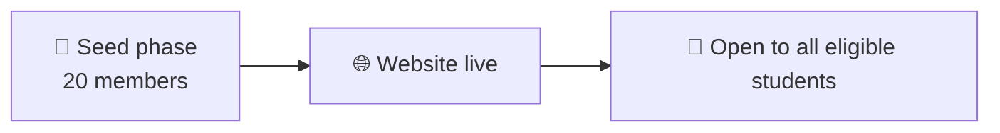

### 🗣️ How we talk

You should be able to say:

> "Why does this architecture make sense?"  
> "I think your assumption is wrong."  
> "Let's test it."  
> "Why is the program doing *that*?"

And someone should be able to answer:

> "I don't know."

And that should be completely fine. 🤷

Serious technical arguments and stupid coding humour can coexist:

```text
"Your abstraction is fundamentally broken."
              ↓
"Bro I spent 6 hours on it 😭"
              ↓
"Okay let's fix it."
```

### 🛡️ What we protect against

Rigidity. Status games. Technology worship. Conformity. Competition obsession. Superficial participation. Internal politics. Building without purpose.

We want different people to become **stronger without becoming identical.**

### 🚨 When someone harms the guild

The principles are clear:

- What actually damages a guild: harassment, discrimination, abuse of rank or power, passing off others' work as one's own. ⚠️
- Only officers bring a case. Any member can raise a concern with any officer. The accused always replies before anything is decided. ⚖️
- The Master Architect's options are narrow and serious: dismiss, drop a rank, or exile.

The procedures are established in the guild constitution.

Exile is rare by design. The default assumption is that people are here to explore, and that mistakes are data.

### 🧭 Core values

| Value | Principle |
|---|---|
| 🧭 **Curiosity** | Investigate instead of pretending to know |
| 🔨 **Creation** | Learn by making |
| 🧪 **Experimentation** | Test ideas against reality |
| 🧠 **Understanding** | Seek mechanisms, not memorization |
| 🏹 **Autonomy** | Own your intellectual territory |
| 🤝 **Collaboration** | Combine different strengths |
| ⚖️ **Equality** | Same floor for everyone; rank earns influence, never privilege |
| 🌍 **Vision** | Look beyond the college bubble |
| 🔄 **Learning** | Turn failure into understanding |
| 🌌 **Possibility** | Leave room for the unknown |

---

## 10. 🌌 Where Does the Expedition Go?

Unknown. **Intentionally.**

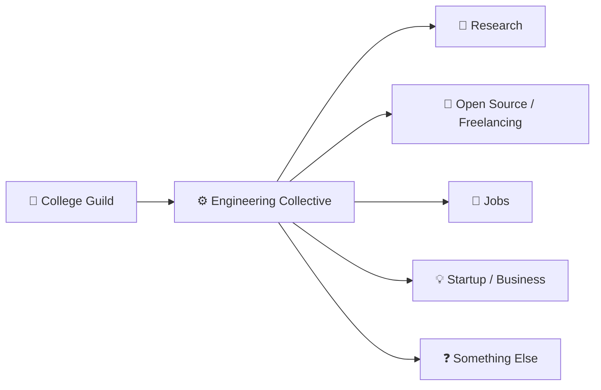

Fixing the final form today would be premature optimisation of the purest kind. 🙃

The mission:

> **To explore meaningful problems through engineering, learn by building, and turn curiosity into systems that are useful beyond the immediate environment.**

Programming is one instrument. **Engineering is how curiosity becomes useful.**

> 🌌 **We do not choose the destination before the journey reveals it.**

---

## 🏛️ The Founding Members

> **This list is closed. It will never be amended.**

Before there were ranks, before there were quests, before the guild had a single line of code to its name, there was a handful of people who looked at an empty map and decided to walk into it.

They did not join the expedition. **They are the expedition.**

They stand outside the rules of inactivity. Silence cannot cost them their place, because their place was not granted. It was **made.**

Whatever the guild becomes, it will be answerable to this first party, and its story will always begin here:

```text
Master Architect  →  Yashasvi

Debug Officers    →  Bittu · Ragni · Suryansh

Git Staff         →  Ishaque · Surbhi

Founding Members  →  Amit · Sahil · Shahan · Priya · Sumit · Ujjwal · Samyak · Rahul · Shivshankar
```

Every guild has an origin. This is ours, inscribed once, **permanently.** 🏛️

---

## 🏹 The Guild Archetype

```text
Individual identity
        +
Technical autonomy
        +
Shared curiosity
        +
Difficult quests
        +
Collective memory
        =
      🏹 GUILD
```

A collection of distinct characters travelling together. Not because they want the same future. Not because they share skills. Not because they share personalities.

Because they are willing to **explore together.**

---

## 🌐 The Home

The guild gets a home on the web: the **कौतूहल website.**

Members will be able to:

- Join the guild.
- View their profile, rank, and class.
- Discover quests and track projects.
- Explore guild history.
- Watch the collective map grow.

Maintained by the **Git Staff**, as part of the guild's infrastructure and memory.

When it goes live, the Master Architect declares it. The seed phase ends. The doors open. 🚪

We are not going to talk about *building* the guild.

**We're going to build the guild too.** 🔨

---

## ✦ Guild Mantra

<p align="center">
  <strong>Curiosité · 探究心 · कौतूहल</strong>
  <br /><br />
  <strong>Wonder → Explore → Build → Understand → Become → Wonder</strong>
  <br /><br />
  <h1 align="right">🏹 Welcome to the expedition.</h1>
</p>

---